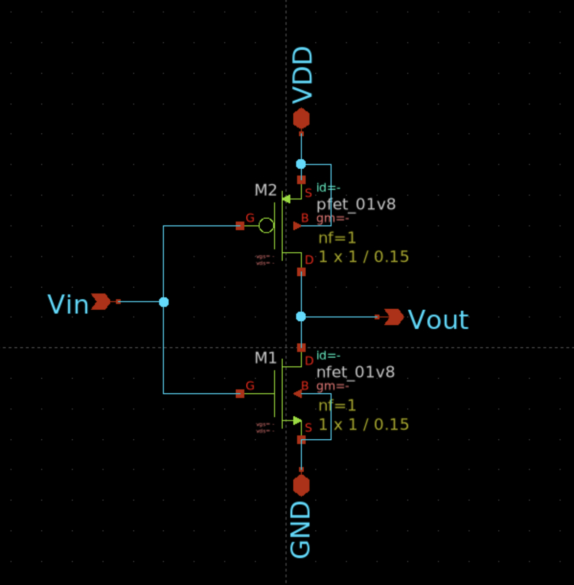
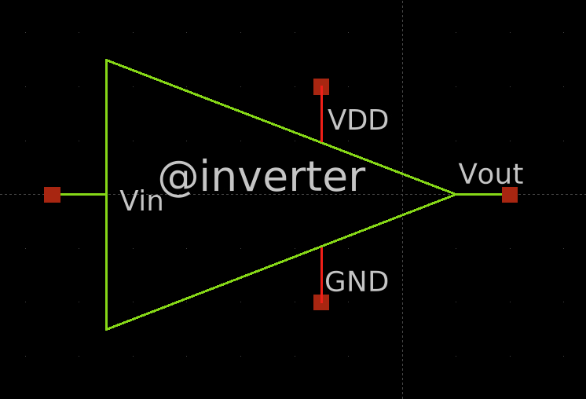
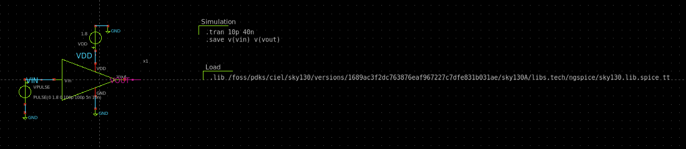
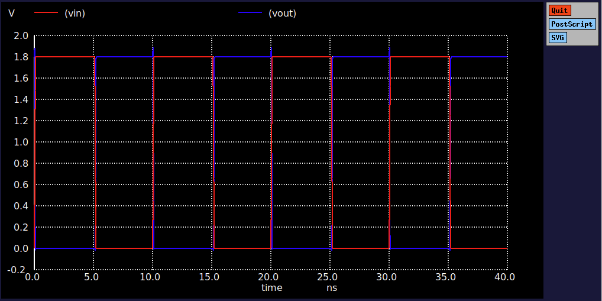

# CMOS Inverter: Design and Simulation

## Overview

In this exercise, you will design and simulate a CMOS inverter using Xschem, the SKY130 Process Design Kit (PDK), and NGspice.

A CMOS inverter is a NOT gate that produces the opposite logic value of its input. It consists of two complementary MOSFETs: one PMOS and one NMOS.

### Step 1: Open Xschem

1. Launch Docker Desktop and start the IIC-OSIC-TOOLS container.
2. Open the browser-based desktop environment.
3. Launch Xschem.
4. Create a new schematic.
5. Save the file as `cmos_inverter.sch`.

### Step 2: Add the MOSFETs

Open the Xschem symbol library.

Using the SKY130 PDK, add:

| Component | Symbol |
|---|---|
| NMOS | `sky130_fd_pr__nfet_01v8` |
| PMOS | `sky130_fd_pr__pfet_01v8` |

Place the PMOS above the NMOS.

Both transistors are 1.8 V devices from the SKY130 PDK.

### Step 3: Connect the Transistors

Connect the devices to form a CMOS inverter:

1. Connect the PMOS and NMOS gates together.
2. Connect both drains together to form the output.
3. Connect the PMOS source to VDD.
4. Connect the NMOS source to VSS (ground).
5. Connect the PMOS bulk to VDD and the NMOS bulk to VSS.

Use the **W** key to draw wires in Xschem.

### Step 4: Add Input and Output Pins

Insert the following symbols from the `devices` library:

| Symbol | Pin Name |
|---|---|
| `ipin.sym` | Vin |
| `opin.sym` | Vout |
| `iopin.sym` | VDD |
| `iopin.sym` | GND |

Place the pins at the appropriate connections.

Your completed schematic should resemble the following:



---

## Part 2: Create the Inverter Symbol

A symbol allows us to reuse the inverter as a single circuit block in other schematics.

### Step 5: Generate the Symbol

1. Save your completed inverter schematic.
2. From the Xschem menu, select **Symbol → Make symbol from schematic**.
3. Xschem generates a symbol containing the four pins defined in the schematic.
4. Save the symbol as `cmos_inverter.sym`.

You can edit the symbol's appearance.



---

## Part 3: Create a Testbench

### Step 6: Create a New Schematic

1. Create a new Xschem schematic.
2. Save it as `cmos_inverter_tb.sch`.
3. Insert the inverter symbol created in Part 2.

The testbench will contain the voltage sources and simulation setup used to verify the inverter.

### Step 7: Add Voltage Sources

From the `devices` library, insert two `vsource.sym` components.

**DC Supply**

Connect the first voltage source between VDD and ground.

Edit its properties to set:

    name=VDD
    value=1.8

**Input Pulse Source**

Connect the second voltage source between Vin and ground.

Set its properties to:

    name=VPULSE
    value="PULSE(0 1.8 0 100p 100p 5n 10n)"

This generates a repeating input signal between 0 V and 1.8 V.

| Parameter | Value | Description |
|---|---|---|
| V1 | 0 V | Low voltage |
| V2 | 1.8 V | High voltage |
| TD | 0 | Initial delay |
| TR | 100 ps | Rise time |
| TF | 100 ps | Fall time |
| PW | 5 ns | Pulse width |
| PER | 10 ns | Period |

NOTE: "Xschem property formatting"
    Keep the quotation marks around the complete PULSE expression. 

### Step 8: Connect and Label the Nets

Connect:

- VDD to the 1.8 V DC source.
- Vin to the pulse source.
- Vout to the output wire.
- GND to the ground reference.

To label the wires:

1. Insert `devices/lab_pin.sym`.
2. Place the label directly on a wire.
3. Edit the `lab` property.

Use the labels:

- `vdd`
- `vin`
- `vout`



---

## Part 4: Configure NGspice

### Step 9: Add the SKY130 Model Library

NGspice needs the SKY130 transistor models to simulate the circuit.

Open a terminal **inside the IIC-OSIC-TOOLS Docker environment** and run:

```bash
find / -name "sky130.lib.spice" 2>/dev/null
```

Copy the full path returned.

In your Xschem testbench:

1. Insert `devices/code_shown.sym`.
2. Open its properties.
3. Set its value to the following, replacing the placeholder with the actual model path:

```text
name=Models
value=".lib /YOUR/ACTUAL/PATH/sky130.lib.spice tt"
```

The `tt` option selects the typical-typical process corner.

### Step 10: Add Transient Analysis

Insert another `devices/code_shown.sym` component.

Set its properties to:

```text
name=Simulation only_toplevel=false
value=".tran 10p 40n"
```

This runs a transient analysis for 40 ns with a time step of 10 ps.

### Step 11: Configure the Simulator

In Xschem:

1. Open **Simulation → Configure simulators and tools**.
2. Select **Ngspice interactive**.
3. Accept and close the configuration window.
4. Make sure **SPICE netlist** is selected under Options.

---

## Part 5: Run the Simulation

### Step 12: Generate the Netlist

1. Save your testbench.
2. Click **Netlist** in Xschem.
3. Open the generated SPICE netlist.

### Step 13: Simulate

Click **Simulate** in Xschem.

NGspice should execute the transient analysis.

A successful run displays the initial operating-point voltages and the number of simulation data rows generated.


### Step 14: Plot the Waveforms

In the NGspice terminal, enter:

```spice
plot v(vin) v(vout)
```

### Step 15: Verify Inverter Operation

Observe the input and output waveforms.

| Input (Vin) | Expected Output (Vout) |
|---|---|
| 0 V | 1.8 V |
| 1.8 V | 0 V |

The output should be the complement of the input.


