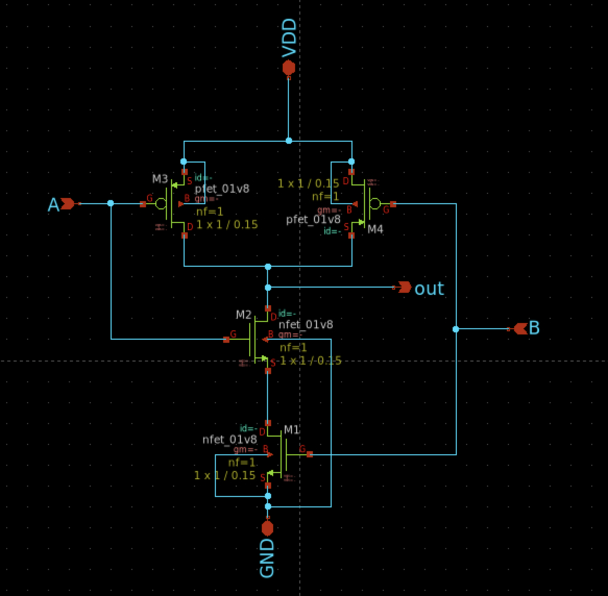
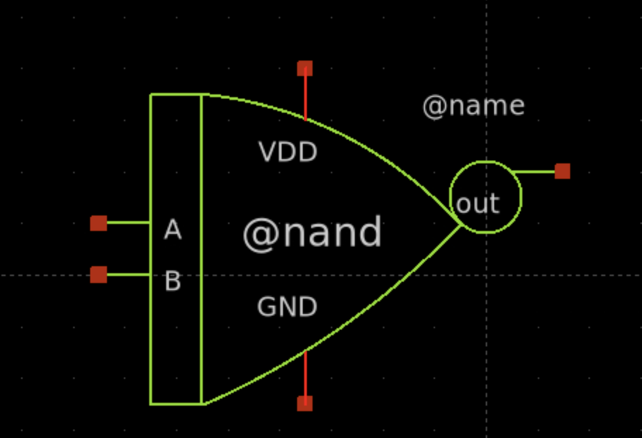
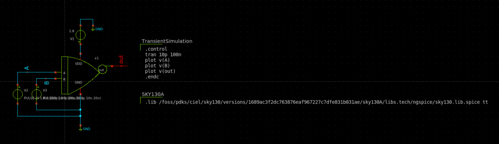
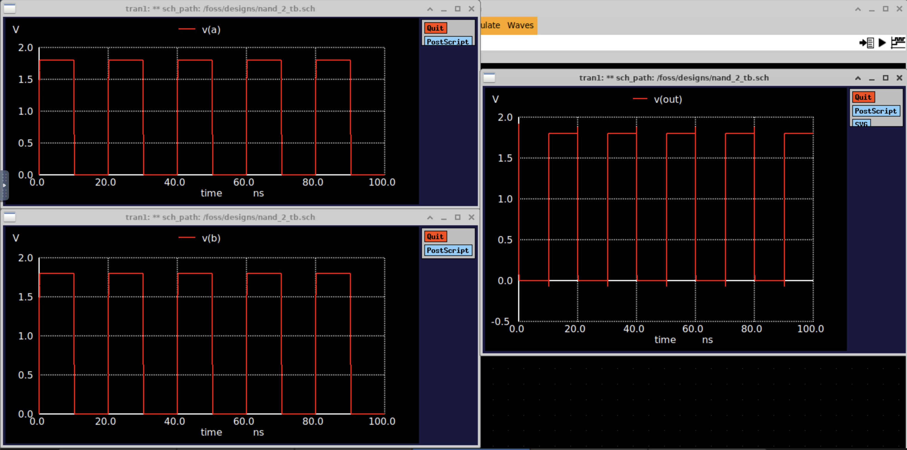

# CMOS NAND Gate: Design and Simulation

## Overview

A NAND gate produces a LOW output only when both inputs are HIGH. It consists of four MOSFETs: two PMOS transistors connected in parallel and two NMOS transistors connected in series.

### Step 1: Open Xschem

1. Launch Docker Desktop and start the IIC-OSIC-TOOLS container.
2. Open the browser-based desktop environment.
3. Launch Xschem.
4. Create a new schematic.
5. Save the file as `cmos_nand.sch`.

### Step 2: Add the MOSFETs

Open the Xschem symbol library.

Using the SKY130 PDK, add:

| Component | Symbol | Quantity |
|---|---|---|
| NMOS | `sky130_fd_pr__nfet_01v8` | 2 |
| PMOS | `sky130_fd_pr__pfet_01v8` | 2 |

Place the two PMOS transistors at the top and the two NMOS transistors vertically below them.

All four transistors are 1.8 V devices from the SKY130 PDK.

### Step 3: Connect the Transistors

Connect the devices to form a CMOS NAND gate:

1. Connect both PMOS sources to VDD.
2. Connect both PMOS drains together to form the output.
3. Connect the two NMOS transistors in series.
4. Connect the upper NMOS drain to the output.
5. Connect the lower NMOS source to GND.
6. Connect the PMOS bulk terminals to VDD and both NMOS bulk terminals to GND.
7. Connect input A to the gates of one PMOS and one NMOS.
8. Connect input B to the gates of the other PMOS and NMOS.

Use the **W** key to draw wires in Xschem.

### Step 4: Add Input and Output Pins

Insert the following symbols from the `devices` library:

| Symbol | Pin Name |
|---|---|
| `ipin.sym` | A |
| `ipin.sym` | B |
| `opin.sym` | out |
| `iopin.sym` | VDD |
| `iopin.sym` | GND |

Place the pins at the appropriate connections.

Your completed schematic should resemble the following:



---

### Step 5: Generate the Symbol

1. Save your completed NAND schematic.
2. From the Xschem menu, select **Symbol → Make symbol from schematic**.
3. Xschem generates a symbol containing the five pins defined in the schematic.
4. Save the symbol as `cmos_nand.sym`.
5. Edit its appearance if desired.



---

### Step 6: Create a Testbench Schematic

1. Create a new Xschem schematic.
2. Save it as `cmos_nand_tb.sch`.
3. Insert the NAND symbol created in Part 2.

### Step 7: Add Voltage Sources

From the `devices` library, insert three `vsource.sym` components.

**DC Supply**

Connect the first voltage source between VDD and ground.

Set its properties to:

```text
name=V1
value=1.8
```

**Input A Pulse Source**

Connect the second voltage source between input A and ground.

Set its properties to:

```text
name=V2
value="PULSE(0 1.8 0 100p 100p 10n 20n)"
```

**Input B Pulse Source**

Connect the third voltage source between input B and ground.

Set its properties to:

```text
name=V3
value="PULSE(0 1.8 0 100p 100p 10n 20n)"
```

### Step 8: Connect and Label the Nets

Connect:

- VDD to the 1.8 V DC supply.
- A to the V2 pulse source.
- B to the V3 pulse source.
- GND to the ground reference.

To label the wires:

1. Insert `devices/lab_pin.sym`.
2. Place the label directly on the wire.
3. Edit its `lab` property.

Use the labels:

- `A`
- `B`
- `out`

Your completed testbench should resemble the following:



---

### Step 9: Add the SKY130 Model Library

NGspice needs the SKY130 transistor models to simulate the circuit.

Open a terminal **inside the IIC-OSIC-TOOLS Docker environment** and run:

```bash
find / -name "sky130.lib.spice" 2>/dev/null
```

Copy the full path returned.

In your Xschem testbench:

1. Insert `devices/code_shown.sym`.
2. Open its properties.
3. Set the value to the following, replacing the placeholder with your actual model path:

```text
name=SKY130A
value=".lib /YOUR/ACTUAL/PATH/sky130.lib.spice tt"
```

### Step 10: Add Transient Analysis

Insert another `devices/code_shown.sym` component.

Set its properties to:

```text
name=TransientSimulation
value=".control
tran 10p 100n
plot v(A)
plot v(B)
plot v(out)
.endc"
```

### Step 11: Configure the Simulator

In Xschem:

1. Open **Simulation → Configure simulators and tools**.
2. Select **Ngspice interactive**.
3. Accept and close the configuration window.
4. Make sure **SPICE netlist** is selected under Options.

---


### Step 12: Generate the Netlist

1. Save your testbench.
2. Click **Netlist** in Xschem.
3. Open the generated SPICE netlist.

### Step 13: Simulate

Click **Simulate** in Xschem.

NGspice should execute the transient analysis and display three separate waveform plots.

### Step 14: Verify NAND Operation

The output should only be LOW when both inputs are HIGH.


