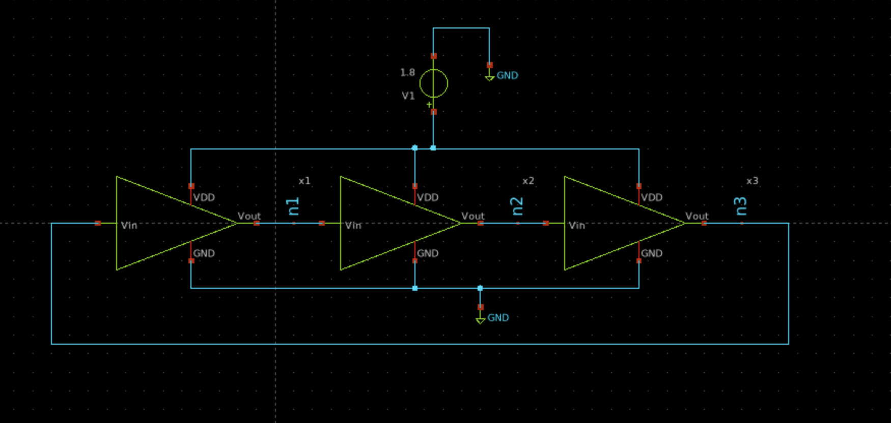
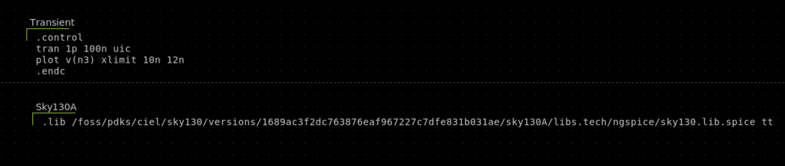
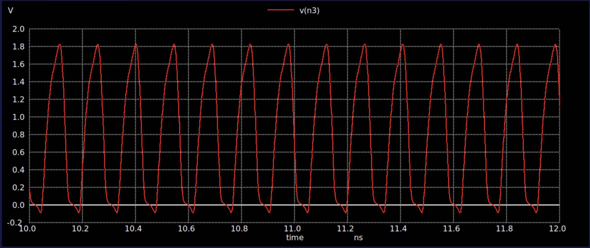

# CMOS Inverter Ring Oscillator: Design and Simulation

## Overview

A ring oscillator consists of an odd number of inverters connected in a feedback loop. The propagation delay of each inverter causes the circuit to oscillate.


### Step 1: Open Xschem

1. Launch Docker Desktop and start the IIC-OSIC-TOOLS container.
2. Open the browser-based desktop environment.
3. Launch Xschem.
4. Create a new schematic.
5. Save the file as `inverter_ring_oscillator.sch`.

### Step 2: Insert the Inverter Symbols

1. Open the Xschem symbol library.
2. Locate the `cmos_inverter.sym` symbol created in the CMOS Inverter tutorial.
3. Insert three instances of the inverter symbol.
4. Arrange them horizontally.

Each inverter symbol should have four pins:

- Vin
- Vout
- VDD
- GND

### Step 3: Connect the Inverters

Connect the three inverters in a feedback loop:

1. Connect the output of inverter 1 to the input of inverter 2.
2. Connect the output of inverter 2 to the input of inverter 3.
3. Connect the output of inverter 3 back to the input of inverter 1.
4. Connect the VDD and GND pins of all three inverters to their respective supply nets.

Use **W** to draw wires in Xschem.

### Step 4: Add the Voltage Source

From the `devices` library, insert `vsource.sym`.

1. Connect the positive terminal to VDD.
2. Connect the negative terminal to GND.
3. Set its properties to:

```text
name=V1
value=1.8
```

### Step 5: Label the Nodes

Use `devices/lab_pin.sym` to label the outputs of the three inverter stages:

- `n1`: Output of inverter 1
- `n2`: Output of inverter 2
- `n3`: Output of inverter 3

The output of inverter 3 (`n3`) is also connected back to the input of inverter 1.

Your completed schematic should resemble the following:



---

### Step 6: Add the SKY130 Model Library

NGspice requires the SKY130 transistor models.

If you already configured the model library in the CMOS Inverter tutorial, reuse the same path.

Otherwise, open a terminal inside the Docker environment and run:

```bash
find / -name "sky130.lib.spice" 2>/dev/null
```

In Xschem:

1. Insert `devices/code_shown.sym`.
2. Open its properties.
3. Enter the following, replacing the placeholder with your actual model path:

```text
name=Sky130A
value=".lib /YOUR/ACTUAL/PATH/sky130.lib.spice tt"
```

### Step 7: Add Transient Analysis

Insert another `devices/code_shown.sym` component.

Set its properties to:

```text
name=Transient
value=".control
tran 1p 100n uic
plot v(n3) xlimit 10n 12n
.endc"
```

The `uic` option skips the initial operating-point calculation.

This runs a transient simulation for 100 ns and displays the waveform between 10 ns and 12 ns.



---

### Step 8: Configure the Simulator

In Xschem:

1. Open **Simulation → Configure simulators and tools**.
2. Select **Ngspice interactive**.
3. Accept and close the configuration window.
4. Make sure **SPICE netlist** is selected under Options.

### Step 9: Generate the Netlist

1. Save the oscillator schematic.
2. Click **Netlist** in Xschem.
3. Open the generated SPICE netlist.
4. Verify that all three inverter instances and supply connections are present.

### Step 10: Simulate

Click **Simulate** in Xschem.

NGspice should execute the transient analysis and display the output waveform.

### Step 11: Verify Oscillation

Observe the waveform at node `n3`.

A successful simulation should show a repeating signal switching between approximately 0 V and 1.8 V.



---