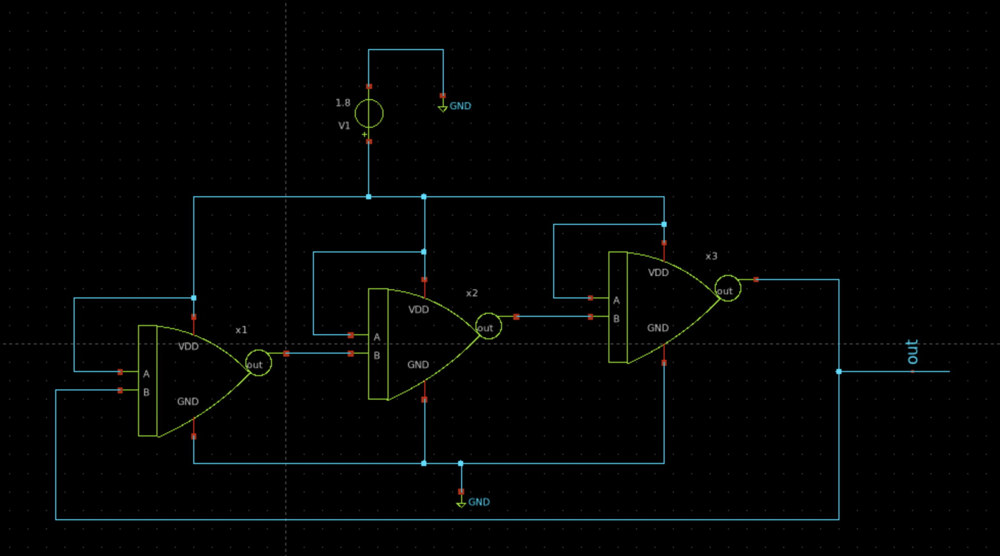
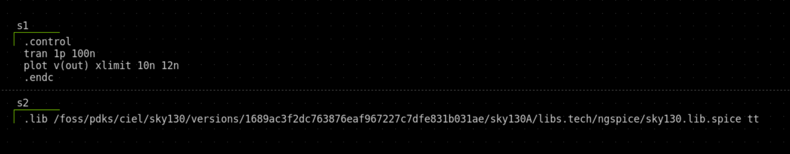
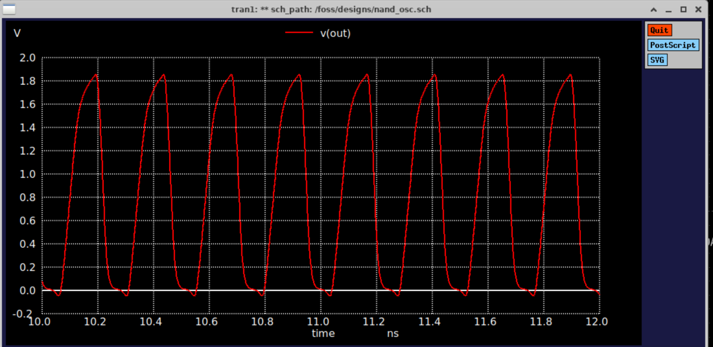

# NAND Ring Oscillator: Design and Simulation

## Overview

A ring oscillator consists of an odd number of inverting stages connected in a feedback loop. In this design, three CMOS NAND gates are configured as inverters to generate an oscillating output.

### Step 1: Open Xschem

1. Launch Docker Desktop and start the IIC-OSIC-TOOLS container.
2. Open the browser-based desktop environment.
3. Launch Xschem.
4. Create a new schematic.
5. Save the file as `nand_ring_oscillator.sch`.

### Step 2: Insert the NAND Symbols

1. Open the Xschem symbol library.
2. Locate the custom `cmos_nand.sym` symbol created in the previous lab.
3. Insert three instances of the NAND symbol.
4. Arrange the three symbols horizontally.

Each NAND symbol should have five pins:

- Input A
- Input B
- Output (`out`)
- VDD
- GND

### Step 3: Configure the NAND Gates as Inverters

A NAND gate behaves as an inverter when one input is held HIGH:

$$
Y = \overline{A \cdot 1} = \overline{A}
$$

For each NAND gate:

1. Connect one input to 1.8 V (logic HIGH).
2. Leave the other input available for the signal from the previous stage.
3. Repeat for all three NAND gates.

### Step 4: Connect the Ring Oscillator

Connect the three NAND gates in a loop:

1. Connect the output of NAND 1 to the signal input of NAND 2.
2. Connect the output of NAND 2 to the signal input of NAND 3.
3. Connect the output of NAND 3 back to the signal input of NAND 1.
4. Connect the remaining input of each NAND gate to logic HIGH (1.8 V).
5. Connect the VDD and GND pins of all three NAND gates to their respective supplies.
6. Label the output of NAND 3 as `out`.

Use the **W** key to draw wires in Xschem.
Your completed schematic should resemble the following:




---

### Step 5: Add the Voltage Source

From the `devices` library, insert a `vsource.sym` component.

1. Connect the positive terminal to VDD.
2. Connect the negative terminal to GND.
3. Set its properties to:

```text
name=V1
value=1.8
```

Use the same VDD net to supply all three NAND gates and hold their unused logic inputs HIGH.

---

### Step 6: Add the SKY130 Model Library

NGspice requires the SKY130 transistor models.

If you have already configured the model library in the previous lab, reuse the same path.

Otherwise, open a terminal inside the Docker environment and run:

```bash
find / -name "sky130.lib.spice" 2>/dev/null
```

In Xschem:

1. Insert `devices/code_shown.sym`.
2. Open its properties.
3. Enter the following, replacing the placeholder with your actual model path:

```text
name=SKY130A
value=".lib /YOUR/ACTUAL/PATH/sky130.lib.spice tt"
```

### Step 7: Add Transient Analysis

Insert another `devices/code_shown.sym` component.

Set its properties to:

```text
name=TransientSimulation
value=".control
tran 1p 100n
plot v(out) xlimit 10n 12n
.endc"
```
---
### Step 8: Configure the Simulator

In Xschem:

1. Open **Simulation → Configure simulators and tools**.
2. Select **Ngspice interactive**.
3. Accept and close the configuration window.
4. Make sure **SPICE netlist** is selected under Options.

### Step 9: Generate the Netlist

1. Save the oscillator schematic.
2. Click **Netlist** in Xschem.
3. Open the generated SPICE netlist.
4. Verify that all three NAND instances and the supply connections are present.

### Step 10: Simulate

Click **Simulate** in Xschem.

NGspice should execute the transient analysis and display the output waveform.

### Step 11: Verify Oscillation

Observe the output waveform.

A successful simulation should show a repeating signal switching between approximately 0 V and 1.8 V.



The waveform may have rounded rising and falling edges due to transistor propagation delays and circuit capacitance.
